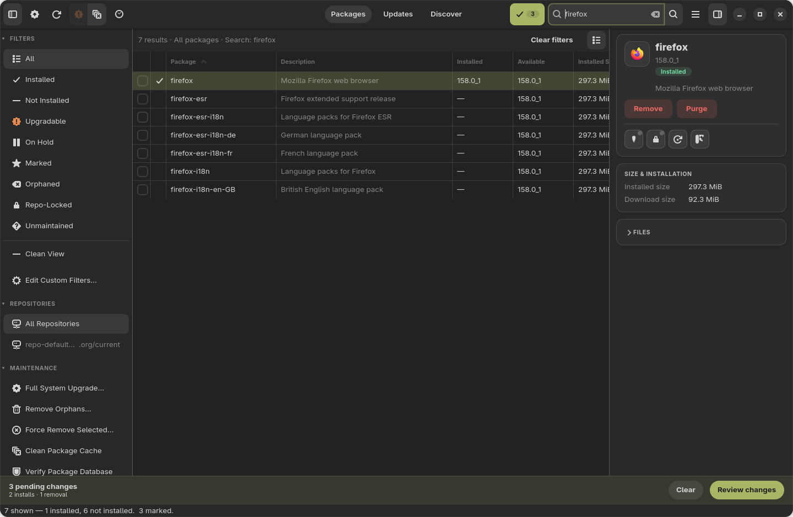

# Caerus

A GTK4 package manager for [Void Linux](https://voidlinux.org/) (XBPS), with
an optional backend for [Chimera Linux](https://chimera-linux.org/) (APK).



More views: [Discover](screenshots/discover.png),
[package details in a narrow window](screenshots/package-details-narrow.png).

## Features

- Packages, Updates and Discover views, with searchable transaction history
- Search by relevance, sort and bulk-mark packages
- Filter by state, repository or custom exclude patterns
- Install, upgrade, remove, purge, force remove, hold and repo-lock
- Full system upgrade, orphan removal, cache cleanup, kernel purge
- Repository and alternatives management
- Dependency-aware previews before anything is applied; mixed changes are
  reviewed and applied one step at a time
- Per-package progress, copyable logs and detailed history
- Discover catalog of 254 applications in 19 sections, limited to what your
  enabled repositories provide (can be hidden)
- Adaptive layout: sidebar, package table and inspector on desktop; bottom
  navigation and a separate details page in narrow windows

The GUI runs unprivileged. Only the small `caerus-helper` is elevated, through
polkit (`pkexec`), so a polkit authentication agent must be running.

## Install

The installer builds the latest release and offers to install it:

```sh
curl -fsSL https://raw.githubusercontent.com/mendescotta/Caerus/main/get-caerus.sh | sh
```

It detects Void or Chimera and installs missing build dependencies with
`xbps-install` or `apk` (through `doas` or `sudo`). Set `CAERUS_REF=main` to
build the development branch, or `CAERUS_SRC_DIR` to choose the checkout path.

### Building by hand

Void Linux:

```sh
xbps-install -S git rust cargo gtk4-devel libxbps-devel glib-devel clang pkg-config polkit
cargo build --release
```

Chimera Linux:

```sh
apk add git rust cargo gtk4-devel glib-devel pkgconf polkit
cargo build --release -p caerus -p caerus-helper --no-default-features --features caerus/apk
```

Add `--features caerus/adwaita` (needs `libadwaita-devel`) for the libadwaita
look. Then install system-wide with `./install.sh` as root, or register the
build for your user only with `./install.sh --user`. Both accept `--uninstall`.
System-wide installation requires the `/usr` layout; custom `PREFIX` values
are rejected because helper discovery and polkit authorization use fixed paths.

## Chimera (APK) backend

The helper detects Chimera through `/etc/os-release` and runs `apk`. Search,
details, repositories, previews, install, remove, updates and system upgrades
work. Void-only tools (purge, hold, repo-lock, kernel purge, alternatives,
orphan removal, cache cleanup, reconfigure, force remove) are disabled.

APK treats `/etc/apk/world` as a set of constraints: removing a package drops
its constraint, so its files stay if something else still requires it. New
installs use `apk add`; marked upgrades use `apk upgrade` and do not add the
package to the world file.

## Development

```sh
cargo fmt --check
cargo clippy --workspace --all-targets -- -D warnings
cargo test --workspace
cargo clippy -p caerus --all-targets --no-default-features --features apk,adwaita -- -D warnings
cargo test -p caerus --no-default-features --features apk,adwaita
```

The GTK smoke test needs a display:
`cargo test -p caerus -- --ignored --test-threads=1`. It uses an unprivileged
helper fixture and never changes host packages. `scripts/debug-run.sh` runs a
debug build with full logging and core dumps; `CAERUS_TRACE_STARTUP=1` logs
startup milestones.

To verify Discover candidates against Void's official binary repository, run
`python3 scripts/check-discover-void.py --desktop-files PACKAGE...`.
The checker ignores configured third-party repositories, fetches metadata in
memory, and reports package versions and desktop filenames as JSON. Use
`--output PATH` to save the report. Results apply to the host XBPS architecture;
other architectures may provide a different set of packages. No packages are
installed or repository configuration changed.

## License

GPL-3.0-or-later — see [LICENSE](LICENSE).
