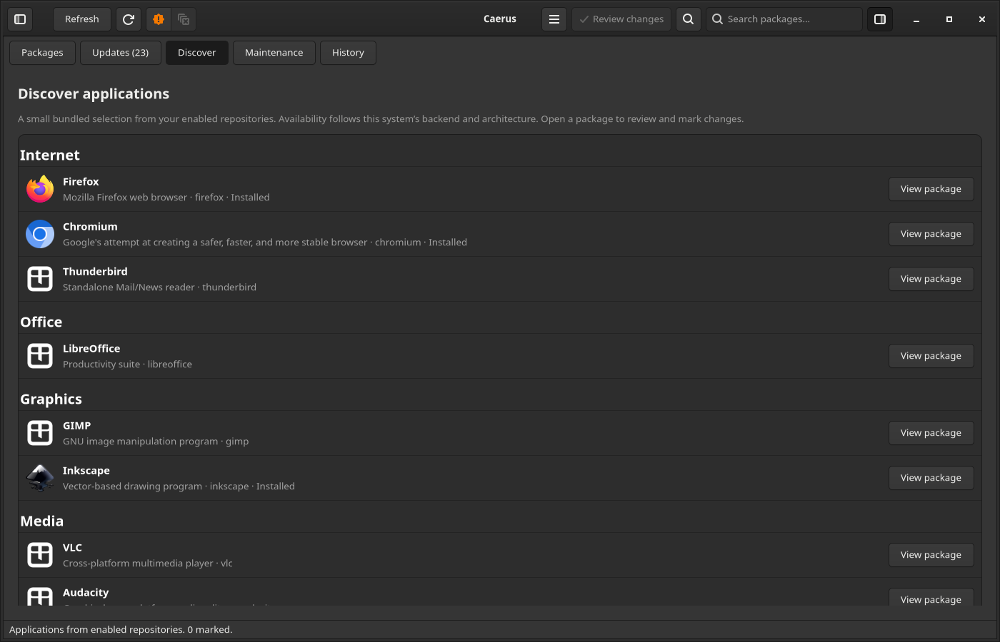

# Caerus

A GTK4 package manager for [Void Linux](https://voidlinux.org/) (XBPS), [Chimera Linux](https://chimera-linux.org/) (APK) and
[Alpine Linux](https://alpinelinux.org/) 3.23+ (APK).


Discover currently lists 743 applications in 28 sections (on Void Linux):



## Features

- Packages, Updates and Discover views, with searchable transaction history
- Search by relevance, sort and bulk-mark packages
- Filter by state, repository or custom exclude patterns
- Install, upgrade, remove, purge, force remove, hold and repo-lock
- Full system upgrade, orphan removal, cache cleanup, kernel purge
- Repository and alternatives management
- Dependency-aware previews before anything is applied; mixed changes are
  reviewed and applied one step at a time
- Per-package progress, copyable logs and detailed history
- Discover catalog of 743 applications and tools in 28 sections, limited to what your
  enabled repositories provide (can be hidden)
- Adaptive layout: sidebar, package table and inspector on desktop; bottom
  navigation and a separate details page in narrow windows

The GUI runs unprivileged. Only the small `caerus-helper` is elevated, through
polkit (`pkexec`), so a polkit authentication agent must be running.

## Install

The installer builds the latest release and offers to install it:

```sh
curl -fsSL https://raw.githubusercontent.com/mendescotta/Caerus/main/get-caerus.sh | sh
```

It detects Void, Chimera or Alpine and installs missing build dependencies with
`xbps-install` or `apk` (through `doas` or `sudo`). Set `CAERUS_REF=main` to
build the development branch, or `CAERUS_SRC_DIR` to choose the checkout path.

### Building by hand

Void Linux:

```sh
xbps-install -S git rust cargo gtk4-devel libxbps-devel glib-devel clang pkg-config polkit
cargo build --release
```

Chimera Linux:

```sh
apk add git rust cargo gtk4-devel glib-devel pkgconf polkit
cargo build --release -p caerus -p caerus-helper --no-default-features --features caerus/apk
```

Alpine Linux (3.23 or newer, which ship apk-tools 3):

```sh
apk add git rust cargo build-base gtk4.0-dev glib-dev pkgconf polkit
cargo build --release -p caerus -p caerus-helper --no-default-features --features caerus/apk
```

`gtk4.0-dev` is in Alpine's `community` repository; enable it with
`setup-apkrepos -c` if `apk add` cannot find it. Alpine edge works too, and so
do derivatives that set `ID_LIKE=alpine` (such as postmarketOS). For a desktop
to run Caerus in, `setup-desktop gnome` installs GNOME with GDM and a polkit
agent.

Add `--features caerus/adwaita` (needs `libadwaita-devel`, or `libadwaita-dev`
on Alpine) for the libadwaita look. Then install system-wide with `./install.sh` as root, or register the
build for your user only with `./install.sh --user`. Both accept `--uninstall`.
System-wide installation requires the `/usr` layout; custom `PREFIX` values
are rejected because helper discovery and polkit authorization use fixed paths.
To remove an older install from another prefix, run
`PREFIX=/usr/local ./install.sh --uninstall` as root.

## APK backend (Chimera, Alpine)

The helper detects Chimera, Alpine and their derivatives (`ID_LIKE`)
through `/etc/os-release` and runs `apk`. It needs apk-tools 3 (`apk query`);
the installer refuses Alpine 3.22 and older. Search, details, repositories,
previews, install, remove, updates and system upgrades work. Removal previews
follow the whole reverse-dependency chain, and a removal that apk would not
carry out (because something else still needs the package) is refused with the
reason. Void-only tools (purge, hold, repo-lock, kernel purge, alternatives,
orphan removal, cache cleanup, reconfigure, force remove) are disabled.

APK treats `/etc/apk/world` as a set of constraints: removing a package drops
its constraint, so its files stay if something else still requires it. New
installs use `apk add`; marked upgrades use `apk upgrade` and do not add the
package to the world file.

## Development

A ready-made Void Linux development environment, including one that shows the GTK
interface in the browser, is available through [Codespaces](.devcontainer/README.md).
Repository review settings and their schema validator are described in
[CodeRabbit configuration](.github/coderabbit.md).

```sh
cargo fmt --all -- --check
cargo clippy --workspace --all-targets --locked -- -D warnings
cargo test --workspace --locked
cargo clippy -p caerus --all-targets --no-default-features --features apk,adwaita --locked -- -D warnings
cargo test -p caerus --no-default-features --features apk,adwaita --locked
```

The GTK smoke test needs a display (CI runs it under `xvfb-run`):
`cargo test -p caerus -- --ignored --test-threads=1`. It uses an unprivileged
helper fixture and never changes host packages. `scripts/debug-run.sh` runs a
debug build with full logging and core dumps; `CAERUS_TRACE_STARTUP=1` logs
startup milestones.

`scripts/test-apk-distros.sh` builds and exercises the APK backend in fresh
Chimera, Alpine and Alpine edge containers (podman): unit tests, the `apk query`
calls, the helper protocol, `install.sh` and a GUI launch under a virtual
display. Pass images (`alpine:3.24`) to pick others, or `ssh:HOST` to run the
same checks on a disposable machine instead; that run changes its packages.
Logs and screenshots go to `temp/apk-distros/`.

To verify Discover candidates against Void's official binary repository, run
`python3 scripts/check-discover-void.py --desktop-files PACKAGE...`.
The checker ignores configured third-party repositories, fetches metadata in
memory, and reports package versions and desktop filenames as JSON. Use
`--output PATH` to save the report. Results apply to the host XBPS architecture;
other architectures may provide a different set of packages. No packages are
installed or repository configuration changed.

Find more candidates with `python3 scripts/check-discover-void.py --discover --nonfree
--output /tmp/discover-candidates.json`, then review the suggestions and verify selected
names with `--desktop-files`. Use `--catalog --nonfree` to audit existing aliases.
The search rules, verification evidence and coverage counts
are documented in [Discover coverage](scripts/discover/README.md). Offline checker tests:
`python3 scripts/test-check-discover-void.py`.

### Scripts

| Script | What it does |
| --- | --- |
| `get-caerus.sh` | Installer: detects Void, Chimera or Alpine, installs build dependencies, builds, then offers to install |
| `install.sh` | Installs a build system-wide (`/usr`) or for one user (`--user`); `--uninstall` removes it |
| `scripts/debug-run.sh` | Debug build (XBPS or APK, chosen from `/etc/os-release`) with full logging and core dumps; `--no-build` runs an existing binary, `--fatal-criticals` aborts on the first GLib critical |
| `scripts/test-apk-distros.sh` | APK backend checks in Chimera/Alpine containers or over SSH |
| `scripts/check-discover-void.py` | Verifies and finds Discover packages in Void's official repository |
| `scripts/check-coderabbit.py` | Validates `.coderabbit.yaml` against CodeRabbit's schema (`uv run`) |
| `scripts/audit.sh` | Flags `unwrap`, `expect`, `downcast`, `panic!`, `unsafe` and `TODO` in Rust sources into `audit-report.json` (needs `rg`) |
| `scripts/test-*.py` | Offline tests for the installer, prefix checks, user install and checkers; CI runs them |

## License

GPL-3.0-or-later — see [LICENSE](LICENSE).
